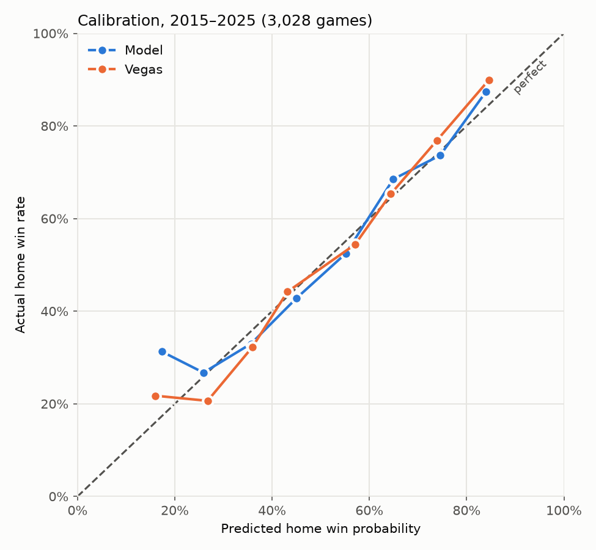

# NFL Game Predictor

Predicts the point margin of every NFL game, then measures those predictions
against the Vegas closing line, the toughest benchmark there is.

Every week's picks are committed to this repo before kickoff.

## Results

Walk-forward backtest over 2,900+ games (2015–2025): each season is predicted
using only games from earlier seasons.

| Model | MAE (points) | Gap to Vegas | Brier score |
|---|---|---|---|
| Home-field baseline | 10.97 | 1.16 | 0.247 |
| Elo (margin of victory, rest) | 10.16 | 0.35 | 0.221 |
| Ridge (EPA + Elo + QB) | 10.07 | 0.27 | 0.219 |
| Ridge + Massey ratings | 10.04 | 0.24 | 0.218 |
| **Hybrid: Elo weeks 1–3, ridge after (current)** | **10.02** | **0.21** | **0.218** |
| *Vegas closing line* | *9.81* | — | *0.212* |

- **MAE:** average number of points a prediction misses the final margin by.
- **Brier score:** accuracy of the win probabilities (0.25 = always guessing 50%).

The current model closes about **82% of the gap** between a naive baseline
and the betting market.

**Holdout check:** before 2024–2025 were folded into the backtest, they were
held out and used once. Ridge's gap to Vegas there was 0.30 (Elo: 0.44), so
its gains held up on unseen seasons.

**Live 2026 record:** starts week 6 (picks updated from Elo to ridge before
kickoff). See [`predictions/`](predictions/).

## Calibration

<p align="center">
  
</p>

When the model gives a team a 65% chance, that team wins about 65% of the
time: every probability bin lands within a few points of perfect, about as
well as the Vegas line. The win-probability spread (13.0 points) was measured
from the model's backtest errors rather than assumed.

## Market check

The model's side against the closing spread was right 51.9% of the time over
3,028 games, just below the 52.4% break-even; its largest disagreements with
the market were its least accurate.
See [`notebooks/market_efficiency.ipynb`](notebooks/market_efficiency.ipynb).

## How it works

1. **Ingest:** downloads schedules, results, Vegas lines, and play-by-play
   for 2006–present from [nflverse](https://github.com/nflverse).
2. **Features**, all computed only from games before kickoff:
   - Offensive and defensive EPA per play over each team's previous 9 games
   - Elo and Massey rating differences
   - QB familiarity: starts in the team's last 15 games
   - Rest days and home field
3. **Model:** ridge regression on those features, except in weeks 1–3,
   when the features are mostly last season's data and Elo is more accurate.
4. **Backtest:** walk-forward by season, so the model never sees the future.
5. **Predict:** each week, retrains on all completed games and saves
   timestamped picks. Projected starting QBs are cross-checked against depth
   charts, with manual overrides for confirmed changes.
6. **Grade:** scores live picks against results, Vegas, and the spread.

## What didn't help

- **Pass-only EPA:** redundant with overall EPA.
- **Early-season EPA adjustments:** narrowed ridge's week 1–3 gap but didn't
  close it, so the pipeline uses Elo for those weeks instead.
- **Gradient boosting (LightGBM):** worse than ridge on the same features
  (10.11 vs 10.07), and blending the two added nothing.
- **Weighting recent seasons more:** no gain; the relationships the model
  learns are stable across eras.

## Usage

```bash
pip install -r requirements.txt
pip install -e .
python -m nflmodel.data.ingest          # download / refresh data
python -m nflmodel.evaluation.backtest  # historical evaluation
python -m nflmodel.predict              # next week's picks
python -m nflmodel.evaluation.grade     # live record so far
```

## Project structure

```
src/nflmodel/
├── config.py          # shared paths and settings
├── data/              # download and clean data
├── features/          # EPA, QB, and the per-game feature table
├── models/            # baseline, Elo, Massey, ridge, hybrid, LightGBM
├── evaluation/        # metrics, backtest, calibration, live grading
└── predict.py         # weekly predictions
notebooks/             # exploration and analysis
reports/               # charts
predictions/           # committed weekly picks (the public record)
```

*For educational purposes only. Not betting advice.*